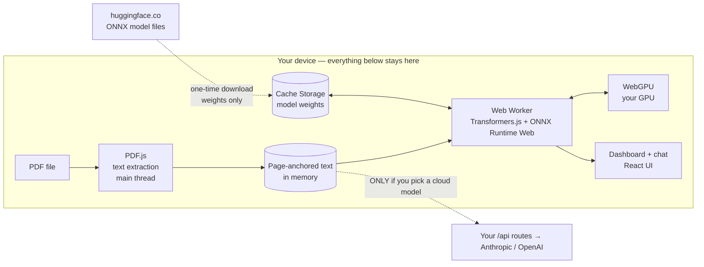
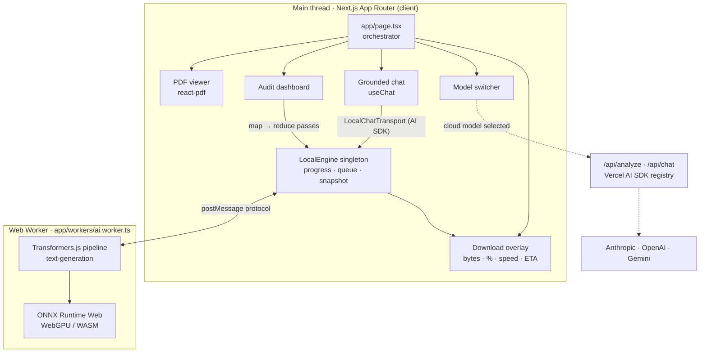
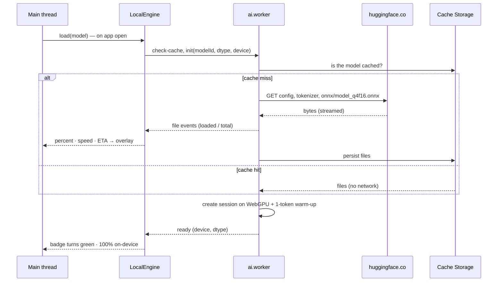

<div align="center">


# DocuLens

### In-Browser AI Document & Contract Auditor

**Enterprise long-context document analysis and risk auditing running 100% locally in your browser using WebGPU & Hugging Face.**

[](https://nextjs.org)
[](https://huggingface.co/docs/transformers.js)
[](https://developer.mozilla.org/docs/Web/API/WebGPU_API)
[](https://www.typescriptlang.org)
[](LICENSE)
[](#-contributing)

**Zero server. Zero uploads. Your contracts never leave the tab.**

[How privacy works](#-how-browser-native-privacy-works) · [Architecture](#-architecture) · [Quick start](#-quick-start) · [Models](#-on-device-models) · [Cloud fallback](#-optional-cloud-fallback) · [Limitations](#-honest-limitations)

</div>

---

> Drop in a contract. DocuLens parses the PDF in your browser, **downloads a small open model straight from Hugging Face into your browser cache once**, and runs it on **your own GPU through WebGPU** inside a Web Worker. You get an executive summary, a High / Medium / Low risk matrix, key financials, expiry dates and deliverables, plus a chat that answers with page-level citations — with no backend ever seeing your document.

<!-- Tip: add a screenshot or GIF of the dashboard here, e.g.  -->

## ✨ Features

| | |
| --- | --- |
| 🔒 **100% local inference** | `@huggingface/transformers` + ONNX Runtime Web execute the model on your GPU via **WebGPU**. Documents never touch a server. |
| ⬇️ **Automatic, cached model download** | On first load the ONNX weights stream from Hugging Face into the browser's Cache Storage. A live overlay shows bytes, %, speed, ETA and per-file progress. Later visits start in seconds — and work **offline**. |
| 🧵 **Web Worker pipeline** | Model download, shader compilation and token generation run off the main thread, so the UI (and the PDF viewer) never freezes. |
| 🧱 **Enforced structured JSON** | The audit is extracted as JSON, parsed defensively (fence-stripping, truncation repair, one retry), validated, and grounded: citations are snapped to real pages and unverifiable quotes are dropped. |
| ⚖️ **Risk matrix** | High / Medium / Low findings in a category × severity heat map, plus a deterministic keyword scan for missing protections (indemnity, liability cap, governing law, data protection, …). |
| 💰 **Financials & timeline** | Fees, caps, payment milestones, effective / expiry / renewal / notice dates and deliverables, each linked to a source page. |
| 💬 **Grounded Q&A** | Streaming chat with `[D1 p.12]` citations. Click a citation → the viewer jumps to the page and highlights the quote. Local retrieval (BM25) feeds the model the most relevant pages. |
| 🖥️ **Split-screen PDF viewer** | Drag-and-drop multi-file bundles, tabs, zoom, keyboard navigation; one page rendered at a time so huge PDFs stay fast. |
| ☁️ **Optional cloud fallback** | Need frontier-model quality? Add an Anthropic / OpenAI (or Gemini) key and switch models in the header. A badge makes it explicit that text leaves your device in that mode. |

## 🔐 How browser-native privacy works

The privacy guarantee is architectural, not a policy promise: **there is no DocuLens server in the on-device path.**



**What crosses the network, exactly**

| Traffic | When | Contains your document? |
| --- | --- | --- |
| `huggingface.co/<model>/resolve/main/…` (config, tokenizer, `.onnx`) | First visit per model, then served from cache | **No** — public model files only |
| ONNX Runtime `.wasm` files | Served from this app's own `/ort/` (copied from `node_modules` on install) | **No** |
| App JS/CSS | Normal page load | **No** |
| `/api/analyze`, `/api/chat` | **Only** when a *cloud* model is selected | **Yes** (extracted text) — the header badge turns amber |

**Verify it yourself**

1. Open DevTools → **Network**, load a PDF and run an audit with an on-device model — you will see no request carrying your text.
2. DevTools → **Application → Cache Storage → `transformers-cache`** shows the persisted weights.
3. Go **offline** and reload: the audit still works.

### Why WebGPU?

Running a transformer in WASM on the CPU works, but it is slow. WebGPU gives the browser direct, sandboxed access to your GPU's compute shaders. Transformers.js hands the ONNX graph to ONNX Runtime Web's WebGPU execution provider; 4-bit weights (`q4f16`) keep the download small and the VRAM footprint modest. If WebGPU is missing — or fails to initialise — DocuLens transparently falls back to the CPU (WASM) backend with 8-bit weights and tells you why.

## 🏗 Architecture



**First-run download**



### How an on-device audit works

Small models can't read a whole contract at once, so DocuLens runs a **map → reduce** pipeline ([`lib/local/analysis.ts`](lib/local/analysis.ts)):

1. **Window** — each document is split into page-aligned windows that fit the model ([`windows.ts`](lib/local/windows.ts)).
2. **Map** — per window, one generation returns a small JSON object (risks, financials, dates, deliverables). Output is parsed leniently ([`json.ts`](lib/local/json.ts)) with one retry.
3. **Ground** — every citation is snapped to a real page; a quote is kept only if it appears verbatim on that page.
4. **Merge** — duplicates are collapsed across windows and the dashboard updates after **every** pass.
5. **Reduce** — one final pass turns the page notes into the executive summary.
6. **Gap scan** — a deterministic keyword check flags protections that are never mentioned ([`gaps.ts`](lib/local/gaps.ts)).

The result has the same shape as the cloud audit, so one dashboard renders both.

## 🚀 Quick start

**Prerequisites:** Node.js ≥ 20.9 (arm64 build on Apple Silicon) and a WebGPU browser — Chrome/Edge 113+ or Safari 26+. No API key needed. See [Apple Silicon](#-apple-silicon-m-series-macs) for Mac specifics.

```bash
git clone https://github.com/YOUR_USERNAME/doculens.git
cd doculens
npm install          # also copies PDF.js + ONNX Runtime assets into /public
npm run dev
```

Open <http://localhost:3000>. The default model (~495 MB) starts downloading immediately; drop a PDF in while it does. Optionally copy `.env.example` to `.env.local` to customise.

| Script | Purpose |
| --- | --- |
| `npm run dev` | Start the dev server |
| `npm run build` / `npm start` | Production build / serve |
| `npm run lint` | ESLint (Next.js core-web-vitals + TypeScript) |
| `npm run typecheck` | Strict TypeScript check |
| `npm run assets` | Re-copy PDF.js and ONNX Runtime assets if `public/pdfjs` or `public/ort` is missing |

> **Tip:** installing `onnxruntime-node` (a transitive dependency used only outside the browser) can download large binaries. Set `ONNXRUNTIME_NODE_INSTALL_CUDA=skip` before `npm install` to avoid it.

### Static hosting

With `NEXT_PUBLIC_CLOUD_FALLBACK=off` the app needs no server logic at all — host it on any static or CDN platform. Serve it over **HTTPS** (WebGPU requires a secure context).

## 🧠 On-device models

Any text-generation ONNX repo from the Hub works; these are built in ([`lib/local/models.ts`](lib/local/models.ts)):

| Model | Repo | Download (q4f16) | Notes |
| --- | --- | --- | --- |
| **Qwen2.5 0.5B** (default) | `onnx-community/Qwen2.5-0.5B-Instruct` | ~495 MB | Best quality for its size |
| SmolLM2 360M | `HuggingFaceTB/SmolLM2-360M-Instruct` | ~276 MB | Smallest download, lighter analysis |
| Qwen2.5 1.5B | `onnx-community/Qwen2.5-1.5B-Instruct` | ~1.2 GB | Higher quality, needs a capable GPU |

The quantisation is chosen automatically: `q4f16` when the GPU supports `shader-f16`, `q4` on other WebGPU devices, `q8` on the CPU fallback. Add your own with:

```bash
NEXT_PUBLIC_DEFAULT_LOCAL_MODEL=onnx-community/your-model-ONNX
```

## 🍎 Apple Silicon (M-series Macs)

DocuLens runs on M1 and later through Metal, with no Mac-specific setup:

| Browser | WebGPU on Apple Silicon | Notes |
| --- | --- | --- |
| Chrome / Edge 113+ | ✅ | Reports `shader-f16`, so the compact `q4f16` weights are used |
| Safari 26+ | ✅ | Ships with macOS Tahoe 26 and installs on Sonoma and Sequoia. Falls back to `q4` weights if `shader-f16` is not exposed |
| Firefox | ⚠️ | WebGPU support is partial, so DocuLens may use the slower CPU (WASM) backend |

- **Unified memory:** the GPU shares system RAM, so the 0.5B model is comfortable on an 8 GB Mac. Prefer the 0.5B or SmolLM2 models over 1.5B on 8 GB machines with many tabs open.
- **Serve over `localhost` or HTTPS.** Opening the dev server by LAN IP over plain HTTP is not a secure context and WebGPU will be unavailable.
- **Safari storage:** Safari may evict site storage after about 7 days without a visit unless the site is added to the Dock (File → Add to Dock), so the model can re-download. Chrome and Edge keep it.
- **Development:** use an arm64 Node.js build (`node -p process.arch` should print `arm64`). An x64 Node under Rosetta installs fine but is slower.
- **CI:** the workflow also builds on an Apple Silicon runner.

## ☁️ Optional cloud fallback

Local-first, cloud-when-you-want-it. Set any of `ANTHROPIC_API_KEY`, `OPENAI_API_KEY`, `GOOGLE_GENERATIVE_AI_API_KEY` in `.env.local` and cloud models appear in the switcher. They run through the Vercel AI SDK provider registry (`provider:model-id` keys, allow-listed, server-only keys) and bring things on-device models can't do: **whole-bundle long-context reasoning and cross-clause conflict detection**. A persistent header badge shows when text leaves your device. Set `NEXT_PUBLIC_CLOUD_FALLBACK=off` to remove the option completely.

## ⚙️ Configuration

| Variable | Default | Description |
| --- | --- | --- |
| `NEXT_PUBLIC_DEFAULT_LOCAL_MODEL` | `onnx-community/Qwen2.5-0.5B-Instruct` | Model selected on first visit |
| `NEXT_PUBLIC_AUTO_DOWNLOAD` | `on` | `off` waits for a click (always deferred under Data Saver) |
| `NEXT_PUBLIC_HF_REMOTE_HOST` | `https://huggingface.co/` | Mirror / proxy with Hub URL layout |
| `NEXT_PUBLIC_ORT_WASM_PATH` | `/ort/` | ONNX Runtime wasm location (`cdn` = library default) |
| `NEXT_PUBLIC_CLOUD_FALLBACK` | `on` | `off` hides cloud models |
| `ANTHROPIC_API_KEY` / `OPENAI_API_KEY` / `GOOGLE_GENERATIVE_AI_API_KEY` | – | Enable cloud models (server-side only) |
| `DOCULENS_DEFAULT_MODEL`, `DOCULENS_EXTRA_MODELS` | – | Cloud model defaults / additions |

## ⚖️ Honest limitations

DocuLens is a **first-pass assistant**, not legal advice.

| | On-device (default) | Cloud (optional) |
| --- | --- | --- |
| Privacy | Nothing leaves the tab | Text sent to the provider |
| Cost | Free, after the download | Per-token |
| Quality | Good for extraction; small models can mislabel severity or miss nuance | Frontier-grade |
| Cross-clause conflicts | Not detected | Detected |
| Missing protections | Keyword scan (no LLM) | LLM analysis |
| Speed | Depends on your GPU; large bundles take many passes (capped at 120) | Fast |

Scanned / image-only PDFs have no text layer and need OCR first. Always verify findings against the cited pages.

## 📁 Project structure

```text
doculens/
├── app/
│   ├── workers/ai.worker.ts      # Transformers.js pipeline, WebGPU session, streaming generation
│   ├── api/                      # optional cloud fallback: analyze · chat · models
│   ├── page.tsx                  # dashboard: viewer · audit · chat · download overlay
│   ├── layout.tsx · globals.css · icon.svg
├── components/
│   ├── engine/                   # download overlay + privacy/engine badge
│   ├── analysis/                 # dashboard, summary, risk matrix, financials, timeline
│   ├── chat/                     # chat sidebar + citation-aware Markdown
│   ├── model-switcher.tsx · header.tsx · landing.tsx · pdf-viewer.tsx · …
├── hooks/                        # engine state, local analysis, model selection, bundle ingestion
├── lib/
│   ├── local/                    # on-device engine
│   │   ├── engine.ts             # worker client: progress, speed/ETA, queue, snapshot store
│   │   ├── models.ts · webgpu.ts · protocol.ts
│   │   ├── analysis.ts · windows.ts · json.ts · gaps.ts · prompts.ts
│   │   └── retrieval.ts · chat-transport.ts
│   ├── ai/                       # cloud: registry, schemas, prompts (shared output schema)
│   ├── documents/                # PDF extraction, page-anchored serialization, citations
│   └── server/api-utils.ts
├── scripts/                      # copy-pdfjs-assets.mjs · copy-ort-assets.mjs
├── .env.example
└── .github/workflows/ci.yml
```

## 🛠 Troubleshooting

| Symptom | Fix |
| --- | --- |
| "No WebGPU" banner | Use Chrome/Edge 113+ (or Safari 26+) over HTTPS/localhost; DocuLens falls back to slow CPU inference meanwhile. On a Mac, update Safari to 26+ or use Chrome/Edge |
| Slow or "retrying on CPU" on a Mac | WebGPU failed to start (often a low-memory or Safari quirk). Close heavy tabs, try SmolLM2 360M, or switch to Chrome/Edge |
| Model fails to load | Retry from the overlay; try SmolLM2 360M; close GPU-heavy tabs; check access to `huggingface.co` |
| Download restarts every visit | Storage may be evicted in private mode or when disk is low; DocuLens requests persistent storage after the first download |
| Behind a proxy / air-gapped | Mirror the model repo and set `NEXT_PUBLIC_HF_REMOTE_HOST` |
| Audit marked "incomplete" | Some passes returned unparseable JSON — re-run or use a larger model |

## 🤝 Contributing

Issues and PRs are welcome — great first contributions: more built-in models, better prompts for small models, OCR for scanned PDFs, tests for the JSON repair and grounding logic.

```bash
git checkout -b feat/my-feature
npm run lint && npm run typecheck && npm run build
```

## 🗺 Roadmap

- [ ] OCR for scanned PDFs (on-device)
- [ ] Embedding-based retrieval (Transformers.js feature-extraction) for chat
- [ ] Cross-clause conflict detection with on-device models
- [ ] DOCX & email ingestion
- [ ] Side-by-side model comparison

## 📄 License

[MIT](LICENSE) — free for personal and commercial use. Model weights are downloaded from Hugging Face under their own licenses — check each model card before redistributing or shipping them.

---

<div align="center">

**If DocuLens saves you from uploading a sensitive contract to someone else's server, please ⭐ star the repo — it helps others find it.**

Built with [Next.js](https://nextjs.org) · [Transformers.js](https://huggingface.co/docs/transformers.js) · [ONNX Runtime Web](https://onnxruntime.ai) · [Vercel AI SDK](https://ai-sdk.dev) · [react-pdf](https://github.com/wojtekmaj/react-pdf) · [Tailwind CSS](https://tailwindcss.com) · [Framer Motion](https://motion.dev)

</div>
