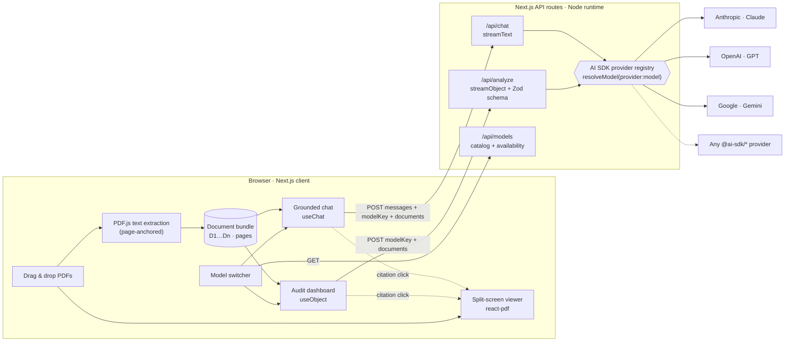
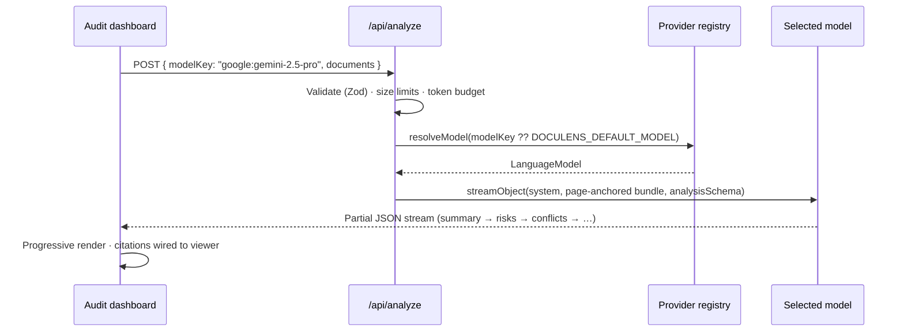

<div align="center">


# DocuLens

### AI-Powered Long-Context Document & Contract Auditor

**Enterprise long-context document analysis, cross-clause risk auditing, and grounded Q&A — powered by your choice of AI model.**

[](https://nextjs.org)
[](https://www.typescriptlang.org)
[](https://ai-sdk.dev)
[](https://tailwindcss.com)
[](LICENSE)
[](#-contributing)

**Claude · GPT · Gemini — switch models at runtime, get the same structured audit.**

[Features](#-features) · [Architecture](#-architecture) · [Model-agnostic design](#-model-agnostic-by-design) · [Quick start](#-quick-start) · [API](#-api-reference) · [Roadmap](#-roadmap)

</div>

---

> Drop in a 300-page MSA together with its SOWs and DPA. In one long-context pass DocuLens returns an executive summary, an exhaustive risk matrix, **conflicts between clauses hundreds of pages apart**, and every fee, milestone and deadline — each finding linked to the exact page. Then interrogate the bundle in chat and **switch between Claude, GPT and Gemini mid-conversation**.

<!-- Tip: add a screenshot or GIF of the dashboard here, e.g.  -->

## ✨ Features

| | |
| --- | --- |
| 🔀 **Truly model-agnostic** | One codebase, any provider. Requests are routed at runtime by a `provider:model-id` key through the Vercel AI SDK provider registry. Add a model with an env var, a provider with three lines. |
| 📚 **Long-context deep audit** | Whole bundles go to the model in a single pass — no chunking, no lossy retrieval — so the model sees definitions, cross-references and schedules together. |
| 🧱 **Unified structured output** | A strict Zod schema (`streamObject`) forces Claude, GPT and Gemini to return the *same* JSON: summary, risks, conflicts, gaps, financials, dates, deliverables. |
| ⚖️ **Exhaustive risk matrix** | High / Medium / Low findings in a category × severity heat map, plus **cross-clause conflicts** across non-adjacent pages and **missing indemnities & compliance gaps**. |
| 💰 **Financials & timeline** | Contract value, fees, payment milestones and triggers, effective/expiration/renewal/notice dates, deliverables with owners and acceptance criteria. |
| 💬 **Grounded Q&A with citations** | Streaming chat (`streamText`) that cites `[D1 p.12 §4.2]` for every claim. Click a citation → the viewer jumps to the page and **highlights the quoted text**. |
| 🖥️ **Split-screen PDF viewer** | Drag-and-drop multi-file bundles, document tabs, zoom, keyboard navigation — renders one page at a time so 1,000-page PDFs stay snappy. |
| 📏 **Context budgeting** | Live token meter against the selected model’s window; server-side budget checks clamp output tokens and reject oversized requests with actionable errors. |
| 🔐 **Privacy & security by default** | PDFs are parsed in the browser; only extracted text reaches the provider. Server-only keys, allow-listed models, request validation, prompt-injection hardening. |

## 🏗 Architecture



**Audit request lifecycle**



### Why long-context instead of RAG?

Contract risk hides in the *interaction* between clauses: a liability cap in §9 neutralised by an indemnity in Schedule C, a defined term on page 2 that changes the meaning of a clause on page 240. Retrieval pipelines fetch the top-k chunks and miss those links. DocuLens serialises the entire bundle into a **page-anchored envelope** and lets 200K–1M-token models reason over all of it at once:

```xml
<document id="D1" name="MSA.pdf" total_pages="42">
<page number="1"> …extracted text… </page>
…
</document>
```

Explicit page tags are what make exact `[D1 p.12]` citations possible on *any* model, without provider-specific citation APIs.

## 🔀 Model-agnostic by design

Every request carries a runtime **model key** — `provider:model-id` — resolved on the server:

```ts
// lib/ai/registry.ts
const registry = createProviderRegistry({ anthropic, openai, google });

export function resolveModel(requestedKey?: string | null) {
  // user selection → DOCULENS_DEFAULT_MODEL → first provider with a configured key
  const key = requestedKey?.trim() || getDefaultModelKey(models);
  // …allow-list + API-key checks…
  return { model: registry.languageModel(spec.key), spec };
}
```

```ts
// app/api/analyze/route.ts — identical code path for every provider
const result = streamObject({ model, schema: analysisSchema, system, prompt, maxOutputTokens });
return result.toTextStreamResponse();
```

| Layer | How it stays provider-neutral |
| --- | --- |
| **Routing** | `createProviderRegistry` maps `anthropic:` / `openai:` / `google:` prefixes to provider instances. |
| **Output contract** | One Zod schema, enforced via each provider’s native structured-output mode (tool use, JSON schema, response schema). Required + nullable fields only — the common denominator all providers accept. |
| **Prompting** | Plain-text instructions + XML-style page envelope; no provider-specific prompt features required. |
| **Chat history** | Provider-neutral UI messages, so you can switch models between turns. Each answer is tagged with the model that produced it. |
| **Caching** | Documents form a stable prompt prefix: Anthropic gets an explicit `cacheControl` breakpoint; OpenAI and Gemini cache stable prefixes automatically. |

### Add a model — no code

```bash
# .env.local
DOCULENS_EXTRA_MODELS=openai:o3=200000,google:gemini-2.5-flash-lite=1048576
DOCULENS_DEFAULT_MODEL=openai:o3
```

### Add a provider — three lines

```bash
npm i @ai-sdk/mistral
```

```ts
// lib/ai/registry.ts
import { mistral } from '@ai-sdk/mistral';
const registry = createProviderRegistry({ anthropic, openai, google, mistral });

// lib/ai/models.ts → PROVIDERS
mistral: { label: 'Mistral', envKey: 'MISTRAL_API_KEY' },
```

Works the same for xAI, Amazon Bedrock, Azure OpenAI, Groq, or any OpenAI-compatible endpoint (Ollama, vLLM) via `@ai-sdk/openai-compatible`.

## 🚀 Quick start

**Prerequisites:** Node.js ≥ 20.9 and at least one API key (Anthropic, OpenAI or Google).

```bash
git clone https://github.com/YOUR_USERNAME/doculens.git
cd doculens
npm install            # also copies PDF.js worker/fonts into public/pdfjs
cp .env.example .env.local
# add at least one provider key to .env.local
npm run dev
```

Open <http://localhost:3000>, drop a PDF (or a whole bundle), pick a model, and click **Audit**.

| Script | Purpose |
| --- | --- |
| `npm run dev` | Start the dev server |
| `npm run build` / `npm start` | Production build / serve |
| `npm run lint` | ESLint (Next.js core-web-vitals + TypeScript rules) |
| `npm run typecheck` | Strict TypeScript check |
| `npm run pdfjs:assets` | Re-copy PDF.js assets if `public/pdfjs` is missing |

### Deploy to Vercel

[](https://vercel.com/new/clone?repository-url=https://github.com/YOUR_USERNAME/doculens&env=ANTHROPIC_API_KEY,OPENAI_API_KEY,GOOGLE_GENERATIVE_AI_API_KEY)

`/api/analyze` declares `maxDuration = 300` for long audits. Note that serverless platforms cap request bodies (Vercel: ~4.5 MB), which bounds the size of bundles you can analyse when deployed; self-hosting with `npm start` has no such cap.

## ⚙️ Configuration

| Variable | Required | Description |
| --- | --- | --- |
| `ANTHROPIC_API_KEY` | one of | Enables Claude models |
| `OPENAI_API_KEY` | one of | Enables GPT models |
| `GOOGLE_GENERATIVE_AI_API_KEY` | one of | Enables Gemini models |
| `DOCULENS_DEFAULT_MODEL` | no | Default `provider:model-id` (auto-registered if not built in) |
| `DOCULENS_EXTRA_MODELS` | no | Extra models: `provider:model-id[=contextTokens]`, comma-separated |

Models whose provider key is missing appear disabled in the switcher with a hint showing which variable to set. Keys are only read server-side and are never sent to the browser.

**Built-in catalog:** Claude Sonnet 4.5 · Claude Opus 4.1 · Claude Haiku 4.5 · GPT-5 · GPT-5 mini · GPT-4.1 (1M) · Gemini 2.5 Pro (1M) · Gemini 2.5 Flash (1M) — edit [`lib/ai/models.ts`](lib/ai/models.ts) to change it.

## 📁 Project structure

```text
doculens/
├── app/
│   ├── api/
│   │   ├── analyze/route.ts      # streamObject → schema-validated audit
│   │   ├── chat/route.ts         # streamText → grounded, cited Q&A
│   │   └── models/route.ts       # model catalog + availability
│   ├── globals.css               # Tailwind v4 + prose / highlight styles
│   ├── icon.svg
│   ├── layout.tsx
│   └── page.tsx                  # Dashboard: viewer · audit · chat
├── components/
│   ├── analysis/                 # dashboard, summary, risk matrix, financials, timeline
│   ├── chat/                     # chat sidebar + citation-aware Markdown
│   ├── ui/primitives.tsx         # badges, skeletons, sections
│   ├── citation-chip.tsx         # clickable [D1 · p.12] chips
│   ├── citation-context.tsx      # citation → viewer navigation
│   ├── context-meter.tsx         # bundle tokens vs. model window
│   ├── document-tabs.tsx
│   ├── header.tsx
│   ├── landing.tsx
│   ├── model-switcher.tsx        # runtime model dropdown
│   ├── notices.tsx
│   ├── pdf-viewer.tsx            # react-pdf viewer with quote highlighting
│   └── upload-dropzone.tsx
├── hooks/                        # bundle ingestion, model selection, toasts
├── lib/
│   ├── ai/
│   │   ├── models.ts             # client-safe model catalog
│   │   ├── prompts.ts            # audit + chat prompts
│   │   ├── registry.ts           # server-only provider registry & resolution
│   │   └── schemas.ts            # Zod output contracts
│   ├── documents/
│   │   ├── citations.ts          # [D1 p.12] parsing → links
│   │   ├── context.ts            # page-anchored serialization, token estimates
│   │   ├── extract.ts            # browser PDF text extraction
│   │   └── pdfjs-config.ts
│   ├── server/api-utils.ts       # validation, budgets, safe errors
│   ├── constants.ts
│   ├── types.ts
│   └── utils.ts
├── scripts/copy-pdfjs-assets.mjs # postinstall: PDF.js worker, cMaps, fonts
├── .env.example
└── .github/workflows/ci.yml      # lint · typecheck · build
```

## 🔌 API reference

<details>
<summary><code>POST /api/analyze</code> — structured audit (streamed)</summary>

```jsonc
{
  "modelKey": "anthropic:claude-sonnet-4-5", // optional — falls back to DOCULENS_DEFAULT_MODEL
  "documents": [
    { "id": "D1", "name": "MSA.pdf", "pages": [{ "page": 1, "text": "…" }] }
  ]
}
```

Returns a text stream of partial JSON matching `analysisSchema` (consume with `useObject`). Errors: `400` invalid body / unknown model · `413` exceeds context window · `503` provider not configured.

</details>

<details>
<summary><code>POST /api/chat</code> — grounded Q&amp;A (UI message stream)</summary>

```jsonc
{ "messages": [/* AI SDK UIMessage[] */], "modelKey": "openai:gpt-5", "documents": [/* … */] }
```

Returns an AI SDK UI message stream (consume with `useChat`). Message metadata includes the model label and token usage.

</details>

<details>
<summary><code>GET /api/models</code> — catalog</summary>

```jsonc
{ "models": [{ "key": "google:gemini-2.5-pro", "label": "Gemini 2.5 Pro", "contextWindow": 1048576, "available": true }], "defaultModelKey": "anthropic:claude-sonnet-4-5" }
```

</details>

## 🔐 Security & privacy

- **Local parsing** — PDFs never leave the browser; only extracted text is sent, to the provider you choose. Nothing is persisted server-side.
- **Server-only secrets** — provider keys are read in route handlers (`server-only` modules); `/api/models` exposes availability, never keys.
- **Model allow-list** — only catalogued models are routable, so clients cannot invoke arbitrary or costly models with your keys.
- **Input validation** — Zod-validated bodies, body-size and bundle-size limits, user/assistant-only chat roles (no client-injected system prompts).
- **Prompt-injection hardening** — document text is treated as untrusted data, and envelope tags inside documents are neutralised.
- **Safe rendering** — Markdown is rendered without raw HTML; PDF text is HTML-escaped before highlighting; PDF.js runs with `isEvalSupported: false`.
- **Safe errors** — provider failures are mapped to generic, actionable messages.

> ⚠️ Before exposing a public deployment, add authentication and rate limiting (e.g. middleware + Upstash) so others can’t spend your API credits. DocuLens assists review; it is not legal advice.

## 🗺 Roadmap

- [ ] OCR for scanned PDFs (Tesseract.js / provider-native PDF input)
- [ ] DOCX & email (`.eml`) ingestion
- [ ] Side-by-side **model comparison** of two audits
- [ ] Redline / clause suggestions exported to Word
- [ ] Playbook mode — audit against your organisation’s standard positions
- [ ] Persistent workspaces (Postgres + object storage)

## 🤝 Contributing

Contributions are welcome! Open an issue to discuss larger changes, then:

```bash
git checkout -b feat/my-feature
npm run lint && npm run typecheck && npm run build
```

Ideas that make great first PRs: new providers, additional schema sections, UI polish, tests.

## 📄 License

[MIT](LICENSE) — free for personal and commercial use.

---

<div align="center">

**If DocuLens saves you an afternoon of contract review, please ⭐ star the repo — it helps others find it.**

Built with [Next.js](https://nextjs.org) · [Vercel AI SDK](https://ai-sdk.dev) · [react-pdf](https://github.com/wojtekmaj/react-pdf) · [Tailwind CSS](https://tailwindcss.com) · [Framer Motion](https://motion.dev)

</div>
